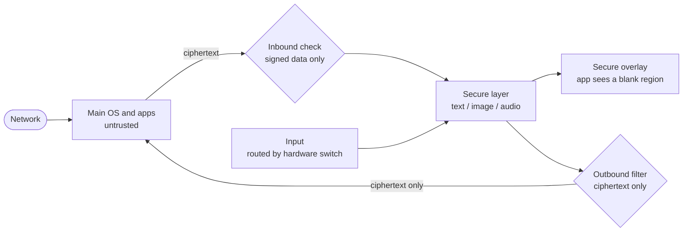

# Secure Layer: keeping secrets away from apps and on-device malware

**Author:** Vance Christian · **Status:** Concept, open for feedback · **Published:** November 2026

A two-phase proposal to keep passwords, banking details and private messages out of reach of apps and on-device malware. Phase 1 uses hardware phones like Pixel already ship. Phase 2 adds dedicated isolation hardware.

## The problem

End-to-end encryption protects data in transit, but a compromised endpoint reads it before encryption and after decryption. Spyware, keyloggers and overlay attacks target exactly that gap. Today, sensitive input such as passwords, card numbers, one-time codes and private messages still passes through the main OS and the app on screen.

**Goal:** Sensitive data should never be readable by the app showing it, the main OS, or malware on the device, while normal apps keep working unchanged.

**Principle:** Keep the secure path as small and simple as possible. Each secure function does one job, accepts one narrow data format, and has as few ways in or out as possible.

## How it works

## Phase 1: ship with today's hardware

1. **Expand protected confirmation into a secure overlay.** Let the trusted UI that already draws payment confirmations draw sensitive fields (password, card, OTP, short message) on top of any app. The app gets a blank region and never the plaintext.
2. **Route keyboard input for those fields to the trusted side.** While a secure field is focused, touch input goes to the trusted execution environment, so keyboard and accessibility keyloggers see nothing.
3. **Send secrets straight to the service, encrypted.** Credentials leave as passkey-style signed or encrypted payloads, never as plaintext handed to the app.
4. **Anchor keys in the secure element** (for example Titan M2), so the main processor never holds them.
5. **Add a trusted indicator** that the main OS can't draw or fake, such as a hardware LED or reserved screen region, shown when the real secure overlay is active.

*Limit:* the display and input path would run in TrustZone on the shared main processor. That's a large improvement, but not full isolation.

## Phase 2: dedicated isolation hardware

1. **Sealed layers:** separate hardware compartments for text, images and audio, each with its own filter. A flaw in one can't reach the others.
2. **One-way inbound:** a data-diode style link. Data enters a layer and can't leave the same way, and a hardware checker rejects anything unsigned.
3. **Filtered one-way outbound:** only ciphertext in a strict, size-limited format can leave. Images are re-rendered from pixels to strip hidden content.
4. **Fixed hardware switch:** simple, non-updatable logic with no software decides which layer owns the display and touch. It's selected by a physical control with a dedicated indicator light.
5. **Single routed keyboard:** all input passes through the secure hardware first. Non-sensitive input is forwarded to apps; sensitive input never is.
6. **Wipe on close:** each session starts clean. Display code reloads from read-only memory and session data is erased.
7. **Modular chip:** a small, stackable module that could become a standard component across phone makers.

## Prior art it builds on

| Existing technology | What it contributes |
|---|---|
| Android protected confirmation | Trusted UI the OS can't spoof |
| Titan M2, Apple Secure Enclave | Separate secure element for keys |
| Passkeys | Secrets never handed to the app or site in plaintext |
| Data diodes, cross-domain solutions | One-way flow and content sanitization |
| Librem 5 hardware kill switches | Fixed hardware controls on a phone |
| Tails OS | Amnesic sessions |

## Trade-offs

**Strengths**
- Protects the highest-value data across every app
- Phase 1 can ship on existing hardware
- Builds on proven, well-understood components
- Raises the cost of on-device spyware sharply

**Limits**
- Doesn't secure the rest of the device
- Services must accept encrypted or signed input
- Phase 2 needs new silicon and certification
- Side channels and physical attacks still apply

## Feedback

This is a concept with no prototype yet. Issues and discussion are welcome, especially on feasibility, attacks I've missed, and existing work this overlaps with.

## License

Released under [CC BY 4.0](https://creativecommons.org/licenses/by/4.0/). Anyone may use, adapt and build on this idea with attribution.
